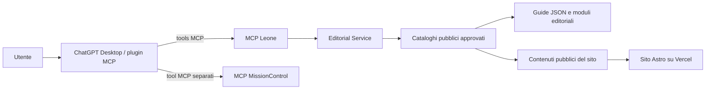

# Architettura MCP Leone Consulting

**Stato:** proposta, non implementata. **Ambito:** consultazione e analisi editoriale del sito pubblico. **Fuori ambito:** ogni funzionalità che tratta denaro, clienti o autorizzazioni premium.

## Obiettivi

1. Esporre a ChatGPT Desktop strumenti editoriali tipizzati, con input e output limitati.
2. Riutilizzare contenuti e validatori già presenti nel repository.
3. Tenere separati MCP Leone, sito Astro/Vercel e MCP MissionControl.
4. Rendere impossibili pubblicazione e operazioni commerciali attraverso il MCP.
5. Avviare la prima versione senza database né servizi commerciali.

## Componenti e confini

ChatGPT Desktop è il client/host che invoca gli strumenti. Il MCP Leone non si connette a ChatGPT. Per la prima versione, ChatGPT può usare anche MissionControl tramite il suo MCP esistente: non serve concatenare due server MCP né dare al MCP Leone accesso generale a MissionControl.

Il MCP è un processo separato dal runtime Astro/Vercel. La separazione evita di aggiungere endpoint MCP pubblici al sito e mantiene fuori dal piano di deploy editoriale un servizio con un diverso perimetro di fiducia. Il codice del server non deve importare o eseguire un percorso generico del filesystem; un servizio editoriale fornisce soltanto operazioni di lettura su record già filtrati e validati.

### Moduli logici

| Modulo | Responsabilità | Limite |
|---|---|---|
| MCP transport | Handshake MCP e dispatch degli strumenti | Nessuna logica editoriale o accesso diretto ai file |
| Tool handlers | Validazione input, limiti, invocazione del servizio | Solo tool allowlisted; nessuna shell o URL arbitraria |
| Editorial service | Elenco, lettura e audit deterministico | Solo contenuti pubblici pubblicati e approvati |
| Content adapter | Lettura dei JSON e metadati del sito | Schema noto; niente lettura di file per path richiesto dal client |
| MissionControl | Contesto e diario del progetto tramite il MCP esistente | Connessione indipendente nella prima versione |
| Human review | Decisione editoriale e pubblicazione | Rimane fuori dal server MCP |

Nel codice, i moduli dovranno essere separati in modo che l’eventuale aggiunta futura di una sorgente (per esempio il catalogo delle bozze) non allarghi implicitamente i permessi del transport o dei tool.

## Trasporto e collocazione

Il trasporto è una decisione aperta, da provare con il plugin e il client Desktop effettivi:

1. **Processo locale via stdio**, se il plugin Desktop scelto supporta un’app MCP locale. Il processo parte con accesso di sola lettura a una sorgente editoriale circoscritta.
2. **Streamable HTTP remoto**, se serve un’app MCP raggiungibile dal servizio ChatGPT. Un processo su macchina privata deve essere raggiunto tramite un tunnel sicuro e autenticato; non esporre una porta MCP anonima su Internet.

La registrazione locale in una configurazione MCP non dimostra da sola che lo strumento sia invocabile nella specifica superficie ChatGPT. La prova d’integrazione deve coprire handshake, enumerazione tool, chiamata effettiva e identità/controlli del trasporto scelto. Le app MCP remote, le app locali dentro un plugin Desktop e i piani ChatGPT hanno requisiti diversi; ricontrollarli prima dell’attivazione nelle [istruzioni OpenAI](https://help.openai.com/en/articles/12584461-developer-mode-and-full-mcp-connectors-in-chatgpt) e nella documentazione dei [plugin](https://help.openai.com/en/articles/20001256-plugins-in-chatgpt).

Non è ancora deciso se eseguire il processo su workstation, Synology o altro host. La scelta dipende dal trasporto verificato, dall’accessibilità stabile della sorgente e dalla possibilità di mantenerlo aggiornato. Nessun servizio o tunnel è stato predisposto.

## Sorgenti editoriali

La sorgente iniziale è il repository, non il database:

- Guide: `company/guides/` e contratto in `src/lib/guides.ts`.
- Pagine pubbliche: catalogo pubblico noto al servizio editoriale; la versione implementata dovrà dichiarare esattamente quali route indicizza.
- Contenuti generati: solo elementi pubblicabili secondo i validatori esistenti e non futuri.

Per le guide si riusano `validateGuide` e `publicGuides`. Il MCP non deve esporre bozze, contenuto premium, file non pubblici o associazioni commerciali non ancora implementate. L’audit lavora sui dati pubblici e restituisce riferimenti e codici di problema, non scansioni arbitrarie del repository.

## MissionControl

### Prima versione

MissionControl resta un MCP distinto. ChatGPT può chiamare il MCP Leone per informazioni editoriali e il MCP MissionControl per contesto o diario, mantenendo visibili le due autorizzazioni. Il MCP Leone non riceve token MissionControl e non eredita i permessi degli strumenti di MissionControl.

### Possibile adapter futuro

Se l’orchestrazione server-to-server diventa necessaria, introdurre un adapter esplicito dietro un’interfaccia di servizio con sole operazioni nominate, ad esempio lettura del contesto del progetto `leoneconsulting.dev` e registrazione di un riepilogo editoriale. L’adapter dovrà usare un’identità di servizio e credenziali custodite fuori dal modello, non un client generico, e fallire chiuso se progetto o permesso non corrispondono. Questa estensione richiede una decisione separata e non è inclusa nei tool v1.

## Contratto MCP

- Nome logico server: `leone-editorial`.
- Namespace contratto applicativo: `leone.mcp.v1`.
- Prima versione: tools soltanto; nessuna resource o prompt che allarghi l’accesso.
- Ogni tool ha schema input chiuso, enum espliciti, limiti di lunghezza e quantità, output bounded e descrizione del fatto che i contenuti sono dati non attendibili.
- Risposte applicative includono versione schema, request ID, esito e risultato tipizzato; errori non contengono stack trace, path locali o segreti.
- Aggiunte compatibili sono opzionali; modifiche breaking richiedono una nuova versione del contratto e il riesame del connettore ChatGPT.

Dettagli: [Tool v1](tools-v1.md).

## Stato e persistenza

La prima versione è stateless e read-only: non richiede database, account utente, sessioni applicative o archiviazione di report. Eventuali dati di audit sono minimizzati e non contengono prompt o copie integrali delle guide. Qualsiasi successivo strumento di bozza avrà un archivio privato esplicito, retention definita e un flusso di revisione; non userà il JSON pubblico come staging.

## Flusso editoriale futuro

La capacità di preparare bozze è fuori dalla v1. Se approvata in seguito:

1. Il MCP crea una proposta non approvata in staging privato con ID/hash.
2. Il validatore verifica struttura, lingua e fonti consentite.
3. MissionControl riceve al massimo riferimento e riepilogo, senza diventare autorità di pubblicazione.
4. Una persona revisiona contenuto e fonti.
5. Un flusso di pubblicazione autorizzato e distinto importa solo il candidato approvato.

Il flusso `scripts/editorial/` già presente riguarda il blog e contiene i propri gate di review e pubblicazione; non va esteso alle guide implicitamente. Qualsiasi integrazione per le guide va progettata e autorizzata separatamente.

## Decisioni aperte

| ID | Decisione | Criterio di chiusura |
|---|---|---|
| D1 | Superficie ChatGPT Desktop e trasporto | Prova reale del plugin/app selezionato; supporto, auth e piano documentati |
| D2 | Host MCP | Sorgente accessibile, aggiornamenti controllati, isolamento e disponibilità adeguati |
| D3 | Confine delle pagine indicizzate | Elenco route pubbliche IT/EN approvato |
| D4 | Audit log | Campi minimizzati, accesso e retention definiti |
| D5 | Adapter MissionControl futuro | Motivazione concreta, API/identità autorizzate e test di isolamento |

