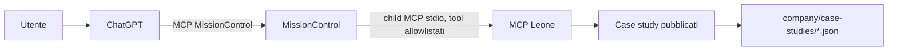

# Architettura MCP Leone Consulting

**Stato:** server v1 e adapter sorgente implementati nei working tree; aggiornamento runtime e prova ChatGPT ancora da completare.
**Direzione autorizzata:** MissionControl → MCP Leone. Il MCP Leone non chiama MissionControl e non riceve credenziali MissionControl.

## Flusso



ChatGPT usa il connettore MissionControl. MissionControl avvia il server Leone
come child MCP locale e inoltra solo le operazioni portfolio approvate. Non viene
esposto un proxy MCP generico: ChatGPT non sceglie repository, comando, percorso o
tool arbitrario.

Un collegamento diretto ChatGPT → MCP Leone via tunnel/HTTPS resta un'opzione
separata; non serve per il flusso v1 richiesto e non è configurato. Nessun endpoint
pubblico, servizio o tunnel viene attivato dal codice di questo repository.

## Componenti

| Modulo | Responsabilità | Confine |
|---|---|---|
| `mcp/manifest.json` | Dichiara il child MCP per MissionControl | Comando fisso Node; nessun segreto o env file |
| `mcp/leone/server.mjs` | Handshake MCP stdio e tool portfolio | Nessun accesso a MissionControl, shell, rete o deploy |
| `mcp/leone/catalog.mjs` | Lettura e proiezione dati pubblici | Directory fissa, file JSON pubblicati, campi espliciti |
| MissionControl | Identità chiamante, allowlist, audit e inoltro | Policy per `chatgpt` e tool `leoneconsulting.dev` |
| ChatGPT | Interfaccia e orchestrazione della richiesta | Non sostituisce i controlli server-side |

Il server usa `@modelcontextprotocol/server` v2 e il trasporto stdio supportato
dal child MCP MissionControl. Il processo scrive esclusivamente protocollo su
stdout; eventuali log devono andare su stderr e non includere contenuti completi.

## Tool v1

- `site_info`: versione del contratto, lingue e capacità read-only.
- `portfolio_list`: metadati di case study pubblicati in `it` o `en`.
- `portfolio_get`: proiezione pubblica di un singolo case study.

Il catalogo usa la stessa regola di visibilità del sito (`published: true`) e
seleziona i file per lingua. Ogni risposta espone solo titolo, settore, sfida,
architettura e approccio pubblicati, risultati, stack/strumenti e ruolo. Esclude
campi cliente, budget/vincoli, testimonial, collegamenti repository/demo e dati
non presenti nella proiezione pubblica MCP. Limiti di input e output sono applicati
server-side.

## MissionControl

Il manifest rende il server individuabile come child `leoneconsulting.dev`.
MissionControl deve mantenere la policy `default deny` e consentire all'identità
`chatgpt` solo `site_info`, `portfolio_list` e `portfolio_get`. Il catalogo del
child viene scoperto dal manager MissionControl; l'abilitazione effettiva richiede
anche la policy operativa nel suo ambiente.

Il connettore ChatGPT MissionControl è curato e non inoltra i child MCP generici.
Nel working tree MissionControl sono stati aggiunti tre tool nominati (`leone_site_info`,
`leone_portfolio_list`, `leone_portfolio_get`) che inoltrano al child MCP. Non
esporre a ChatGPT `call_child_tool` generico né credenziali operatore. Le modifiche
MissionControl non sono ancora committate, attivate o verificate dal connettore.
Il repository Leone non può impostare policy o stato runtime MissionControl.

Non esistono chiamate inverse: il server Leone non importa client MissionControl,
non apre connessioni verso MissionControl e non riceve token, URL o identità MC.

## Avvio locale

Da root repository:

```bash
npm run mcp:leone
```

Per il child MissionControl il comando è dichiarato in `mcp/manifest.json`.
La registrazione locale non equivale alla disponibilità nel connettore ChatGPT;
la prova completa deve passare dal tool MissionControl e arrivare a una scheda
nota del portfolio.

## Controlli di completamento

1. Handshake MCP e discovery dei tre tool dal processo child.
2. Chiamate portfolio IT/EN attraverso MissionControl con identità `chatgpt`.
3. Test negativo su bozze, slug traversal, schema extra, symlink e limiti.
4. Verifica che nessun tool, codice o configurazione nel MCP Leone consenta
   letture o scritture MissionControl.
5. Nessun publish/deploy finché collegamento e policy non sono verificati.
