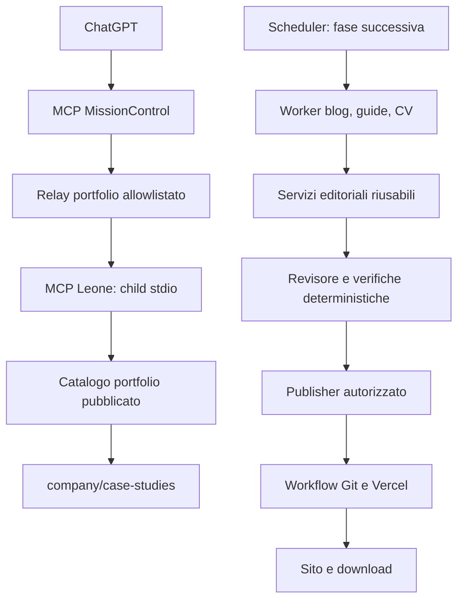

# MCP Leone Consulting — architettura e piano di realizzazione

Stato al 5 novembre 2026: server MCP Leone e adapter curato in MissionControl
implementati nei rispettivi working tree; non committati né attivati nel runtime.
La chiamata end-to-end dal connettore ChatGPT resta da verificare.

## Obiettivo e ordine di lavoro

Esporre il portfolio pubblico di `leoneconsulting.dev` tramite un child MCP stdio.
MissionControl invoca i tool Leone nominati; ChatGPT usa questi tool attraverso il
connettore MissionControl. Il flusso è unidirezionale: il server Leone non accede
a MissionControl. Agenti editoriali e pubblicazione automatica restano fasi future.
Il sito Astro/Vercel continua a leggere i contenuti del repository; il server MCP
rimane un processo separato.

Questa roadmap estende la proposta iniziale: la v1 rimane in lettura; bozze,
orchestrazione e pubblicazione appartengono a fasi successive con permessi propri.
L'esclusione di dati commerciali, clienti, premium e segreti resta valida.

## Requisiti concordati

| Area | Requisito |
|---|---|
| Blog | Esecuzione giornaliera; riuso della pipeline esistente; pubblicazione automatica dopo controlli |
| Guide | Esecuzione settimanale; nuovi contenuti e manutenzione delle guide |
| CV | Revisione mensile, sostitutiva della cadenza settimanale precedente; aggiornamento soltanto con novità verificabili |
| Lingue | Contenuti e controlli IT/EN; CV web, PDF e DOCX alimentati dallo stesso JSON |
| Pubblicazione blog | Nessuna attesa di conferma YubiKey per ogni articolo; autorità automatica esplicita e circoscritta |
| Revisione | Agente revisore scientifico-editoriale, evidenze tracciate e controlli deterministici |
| Operatività | Contesto, stato, riferimenti agli artefatti ed errori consultabili in MissionControl |

La frequenza indica una verifica pianificata, non l'obbligo di produrre contenuto
in assenza di novità. Orari, limiti quantitativi e autorizzazioni automatiche di
guide e CV saranno definiti prima dell'attivazione dei relativi worker.

## Stato verificato e componenti da riusare

- `mcp/leone/`: server MCP stdio, catalogo portfolio pubblico e manifest child.
- `docs/mcp/`: contratto v1 implementato e confini di sicurezza.
- `src/lib/blog.ts` e `src/lib/guides.ts`: contratti e validatori dei contenuti.
- `company/blog/`, `company/guides/`, `company/case-studies/`, `company/cv.json`:
  sorgenti di contenuto; il catalogo MCP applicherà filtri e proiezioni pubbliche.
- `scripts/editorial/run.mjs`, `inbox.mjs`, `delivery.mjs`: raccolta, generazione,
  staging e consegna blog; preservare deduplicazione, lock e riconciliazione.
- `scripts/editorial/publish.mjs`: publisher deterministico con controlli sul
  repository, digest e ricevute di deploy; oggi dipende dall'approvazione personale.
- MissionControl: adapter sorgente per `site_info`, `portfolio_list` e
  `portfolio_get`; le modifiche sono nel working tree ma runtime e connettore
  ChatGPT non sono ancora stati aggiornati.

Il runtime installato può usare snapshot diverse dai sorgenti. Prima di cambiare
cadenze occorre inventariare unit effettive, identità e snapshot: README e messaggi
di attivazione presentano indicazioni giornaliere/settimanali non uniformi.

## Architettura



### Responsabilità

1. **Trasporto MCP:** handshake, negoziazione, elenco tool, dispatch; nessuna
   inferenza, scrittura Git o lettura arbitraria del filesystem.
2. **Handler:** validazione di input/output, limiti e mappatura degli errori.
3. **Servizi di dominio:** catalogo, lettura, ricerca e audit; riusabili dai worker
   senza obbligarli a passare attraverso un client MCP.
4. **Adapter MissionControl:** inoltra solo i tre tool portfolio; non esiste
   un proxy generico e non esiste un collegamento inverso dal server Leone.
5. **Worker e scheduler:** lavori asincroni e ricorrenze; indipendenti dalla chat.
6. **Publisher:** unica responsabilità di applicare un artefatto autorizzato e
   verificare il risultato remoto. Gli agenti non ricevono credenziali Git/deploy.

Proposta di collocazione: `mcp/leone/` per entrypoint e contratti MCP;
`src/lib/editorial/` per logica pura condivisa quando utile; adattatori e controller
runtime fuori dai componenti Astro. I moduli esistenti si estraggono solo quando
serve riusarli, senza riscrivere la pipeline blog.

## Fase 1 — server MCP in lettura

Server Node in JavaScript ESM con SDK MCP ufficiale v2.
Nessun database, endpoint Vercel o servizio AI necessario per questa fase.

Trasporto: **stdio**, avviato dal child MCP MissionControl sullo stesso host.
Un endpoint remoto diretto per ChatGPT non fa parte del flusso v1 e non viene
esposto; se richiesto in seguito, usare un tunnel supportato o Streamable HTTP
autenticato dopo una revisione separata.

### Catalogo e strumenti

| Tool | Input principale | Risultato |
|---|---|---|
| `site_info` | nessuno | Versione contratto, capacità e lingue |
| `portfolio_list` | lingua, limite | Metadati dei case study pubblicati |
| `portfolio_get` | slug, lingua | Proiezione limitata di un case study pubblicato |

Guide, CV, ricerca e audit editoriale non fanno parte della v1 corrente.

Ogni record include URL pubblica, lingua, tipo e revisione della sorgente. La
revisione identifica lo snapshot letto, non certifica che quel commit sia già in
produzione. La provenienza locale/live deve essere esplicita.

I filtri di pubblicazione vengono applicati dal server anche nelle letture dirette:
bozze, date future e guide non gratuite restano escluse. Riutilizzare i filtri
esistenti verificandone la compatibilità fuori dal runtime Astro/Vite; eventuali
glob vengono sostituiti da un adapter Node circoscritto, non da path forniti al tool.

### Contratto applicativo

Namespace `leone.mcp.v1`. Input JSON chiusi, enum `it/en`, slug validati,
paginazione e output limitati. Prima dell'implementazione fissare schema e limiti
per ogni tool; riferimento iniziale: liste massimo 50, ricerca massimo 20,
finding massimo 200, dimensione risposta massimo 256 KiB e timeout lettura 10 s.

```json
{
  "schema_version": "leone.mcp.v1",
  "request_id": "server-generated-id",
  "status": "ok",
  "source": {"kind": "repository_snapshot", "revision": "commit-id"},
  "data": {},
  "warnings": []
}
```

Errori applicativi: `INVALID_ARGUMENT`, `NOT_FOUND`, `SOURCE_UNAVAILABLE`,
`RESULT_LIMIT`, `INTERNAL_ERROR`; risposte tool coerenti con `isError`, distinte
dagli errori di protocollo MCP. Nessuno stack trace o percorso privato restituito.
Output non attendibili come istruzioni: il contenuto è sempre dato.

### Criteri di completamento della fase 1

- Test reali del client Desktop: handshake, elenco tool e chiamata su contenuto noto.
- Test positivi IT/EN e negativi per draft, premium, futuro, path traversal,
  proprietà extra, limiti e sorgente indisponibile.
- Confronto tra catalogo MCP e filtri pubblici del sito su fixture realistiche.
- Prova di arresto/riavvio e dimostrazione di assenza di scritture e tool shell.
- Build del sito su copia pulita; configurazione del client documentata senza segreti.
- Revisione del codice e rapporto dei test prima dell'attivazione stabile.

## Fase 2 — relay MissionControl e ChatGPT

Il manifest Leone permette al manager MissionControl di avviare il child MCP.
L'adapter MissionControl espone tool nominati e read-only; ChatGPT li usa dal
connettore MissionControl. Il relay accetta solo `site_info`, `portfolio_list` e
`portfolio_get`, con lingua e slug validati e risposta limitata. Non inoltra
comandi, URL, percorsi, tool arbitrari o credenziali.

Il MCP Leone non chiama MissionControl, non legge contesto/diario e non riceve
token operatore. Il connettore ChatGPT conserva la propria autenticazione;
aggiornamento/publish della nuova lista tool e prova end-to-end sono ancora aperti.

I futuri tool `editorial_run_request` e `editorial_run_status` restituiscono ID di
lavoro, non eseguono una generazione lunga dentro la chiamata MCP. Chiave di
idempotenza per richieste ripetute; stati ed errori consultabili e persistenti.
Se MissionControl non è disponibile, le letture pubbliche rimangono utilizzabili;
le operazioni che richiedono autorizzazione o ricevute si fermano.

## Fase 3 — agenti editoriali e revisore

Separare redattore blog, manutentore guide, curatore CV e revisore: responsabilità
e permessi distinti, senza imporre quattro processi o provider diversi.
Riutilizzare launcher e backend già autorizzati; modelli e budget vanno definiti
prima di avviare inferenza. Il revisore non è una certificazione scientifica.

Per ogni affermazione verificabile conservare ID, fonte, estratto pertinente,
data di recupero e relazione con la bozza. Il revisore confronta le evidenze,
separa fatti e analisi, qualifica preprint/annunci/benchmark, verifica numeri,
date, limiti e fedeltà IT/EN. Non basta che l'URL esista né un punteggio di fiducia.

Esiti: `approved`, `changes_required`, `insufficient_evidence`. Proposta: massimo
due cicli di correzione, poi blocco e segnalazione. Ogni modifica invalida il
verdetto precedente: bozza, evidenze, policy e risultato sono legati da digest.
Contraddizioni o fonti mancanti non vengono risolte inventando contenuti.

Test: errori fattuali noti, numeri alterati, traduzioni divergenti, evidenze
insufficienti e prompt injection nelle fonti devono produrre un blocco verificabile.
Una prova con esiti raccolti precede l'abilitazione della pubblicazione automatica.

## Fase 4 — pubblicazione automatica e ricorrenze

Estendere l'autorità MissionControl e il publisher con un percorso automatico
esplicito. Non creare false approvazioni a nome di Mario e non disattivare
globalmente la YubiKey. Conservare il percorso manuale come operazione distinta.

L'autorizzazione automatica vincola progetto, repository, tipo di contenuto,
percorso ammesso, versione/digest, policy e identità del servizio. Nessun tool
MCP concede direttamente shell, commit generici, deploy o modifica delle policy.
La validazione finale è deterministica e resta responsabilità del publisher.

```text
scheduled → collecting → drafting → reviewing → validated
          → authorized → publishing → verifying → published
                         ↘ blocked / failed / no_change
```

Gli stati rappresentano lavori distinti e durevoli. Timeout dopo scrittura remota:
riconciliazione prima di ritentare. Lock, deduplicazione e idempotenza impediscono
doppi articoli/commit. Indisponibilità o esito ambiguo non equivalgono a successo.
La verifica finale controlla commit/deployment esatti e pagine IT/EN effettive.

Ricorrenze concordate: blog giornaliero, guide settimanali, CV mensile. Migrare
le schedulazioni esistenti evitando doppioni. Proposta orari: mantenere il blog
alle 09:00 Europe/Rome, guide il lunedì e CV il primo lunedì del mese; orari da
confermare sul runtime. Un interruttore operativo deve fermare nuovi incarichi
automatici senza interrompere il sito o cancellare lo storico.

CV: fonti interne ammesse soltanto al curatore privato, con proiezione pubblico-safe;
mai hostname, segreti, clienti o metriche inventate. Studi e lingue cambiano solo
su indicazione esplicita di Mario. Nessuna novità significa `no_change`.
Guide: partire da contenuti gratuiti, mantenendo esclusi accessi e dati commerciali.

## Validazione, rollout e ripristino

1. MCP read-only testato con Desktop e catalogo reale.
2. Contesto MissionControl verificato sul progetto esatto.
3. Worker in prova: bozze e report, senza pubblicazione automatica.
4. Revisore valutato e policy automatica testata, inclusi casi di rifiuto.
5. Primo ciclo editoriale completo controllato; poi abilitazione delle ricorrenze.

Ripristino: disabilitare scheduler/autorità automatica, conservare artefatti e
ricevute; usare la precedente snapshot funzionante. Eventuali correzioni di
contenuti pubblicati avvengono con nuovi commit verificati, senza riscrivere la
storia. Nessuna modifica a produzione, sicurezza o timer prima delle relative
verifiche e dell'autorizzazione di attivazione.

## Decisioni ancora aperte

| Decisione | Evidenza necessaria |
|---|---|
| Host e trasporto Desktop | Macchina effettiva, raggiungibilità e chiamata reale |
| SDK/versione | Documentazione ufficiale corrente e compatibilità Node |
| Snapshot contenuti | Meccanismo aggiornamento, revisione visibile e filtri pubblici |
| API e identità MissionControl | Ispezione del servizio esistente e test di isolamento |
| Cadenze installate | Unit/snapshot/identità runtime effettive |
| Autorità automatica guide/CV | Perimetro esplicito prima della pubblicazione automatica |
| Modelli, budget e soglie editoriali | Prova su corpus, limiti misurati ed esiti di blocco |

## Riferimenti

- [Architettura iniziale](architecture.md), [contratti candidati](tools-v1.md),
  [confini di sicurezza](security-boundaries.md).
- [Pipeline blog esistente](../../scripts/editorial/README.md).
- [OpenAI: configurazione MCP Desktop](https://learn.chatgpt.com/docs/extend/mcp?surface=app).
  Supporto effettivo da provare nel client selezionato.
- Skill consultate: `architecture-software-architect`, `architecture-api-contracts`.
  Applicati separazione degli strati, isolamento dei guasti, contratti versionati,
  idempotenza e limiti; non importate le scelte infrastrutturali del progetto trading.
